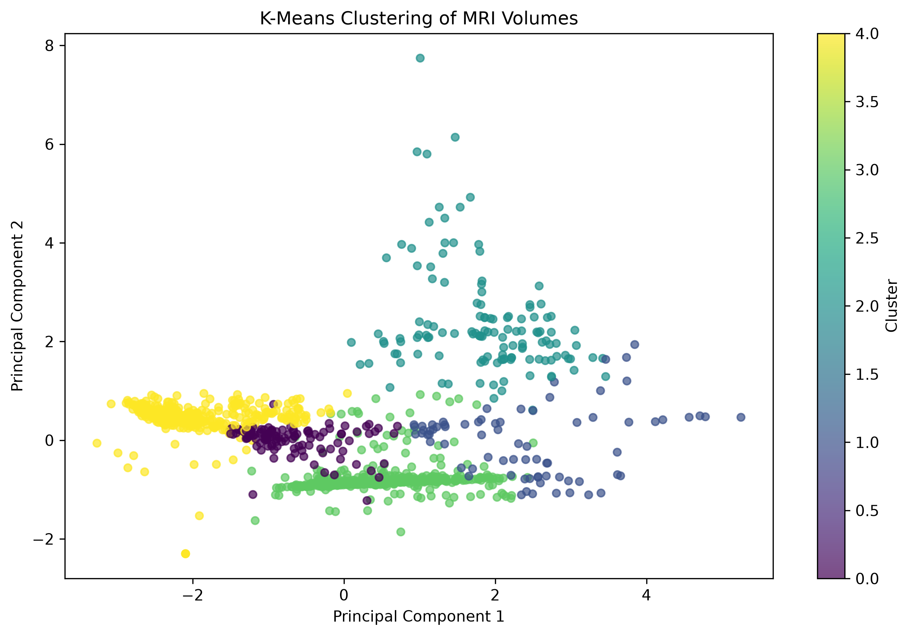
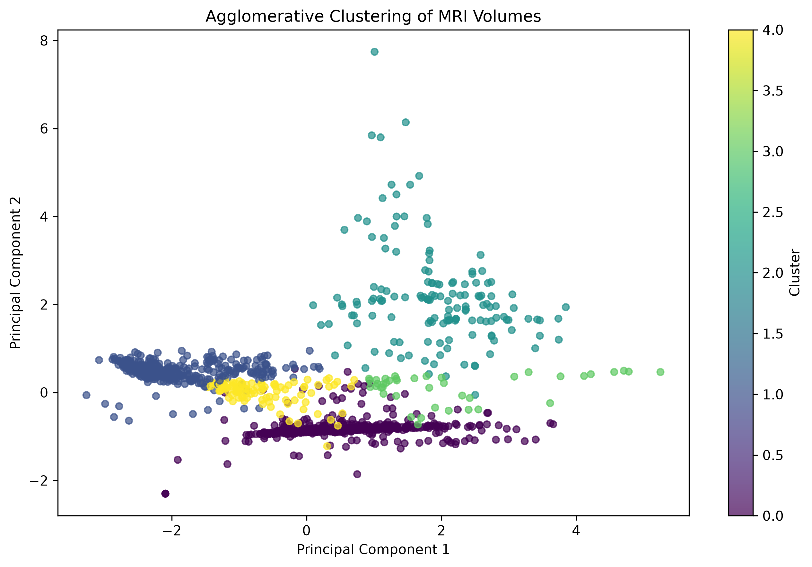

Lumbar Spine MRI Clustering Using Machine Learning

Project Overview

This project explores unsupervised machine learning techniques to group lumbar spine MRI volumes based on numerical image features.

Dataset

The combined dataset contains 1,237 MRI volumes from four source folders:

* processed_lsd: 515 volumes
* processed_osf: 34 volumes
* processed_spider: 210 volumes
* processed_tseg: 478 volumes

Features Used

* Mean intensity
* Standard deviation of intensity
* Median intensity
* Nonzero voxel ratio
* Number of slices

The features were standardized before clustering.

Machine Learning Algorithms

1. K-Means Clustering
2. Agglomerative Clustering

Both algorithms were configured to create five clusters.

Results

Algorithm	        Silhouette Score
K-Means                 	0.5474
Agglomerative Clustering	0.5457

PCA was used to visualize the cluster assignments in two dimensions.

Project Outputs

* Combined clustering results
* Cluster summaries
* Evaluation scores
* PCA cluster visualizations
* Project summary and report

Limitations

The clusters represent similarities in the selected image features and are not confirmed medical diagnoses. Differences between the source datasets may influence the clustering results. Further validation is required before making clinical claims.

Tools and Libraries

* Python
* NumPy
* Pandas
* Scikit-learn
* Matplotlib
* Jupyter Notebook

Author

Devadharshini S

## Results and Visualizations

### K-Means Clustering

### Agglomerative Clustering

